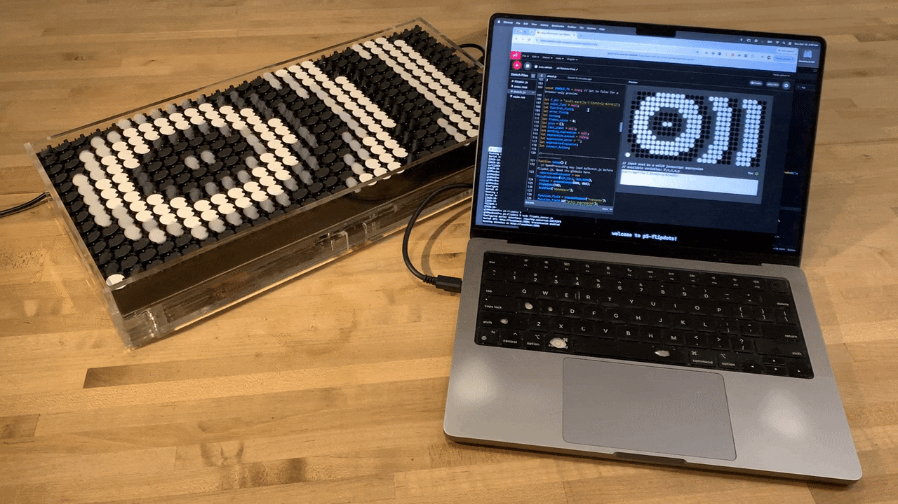
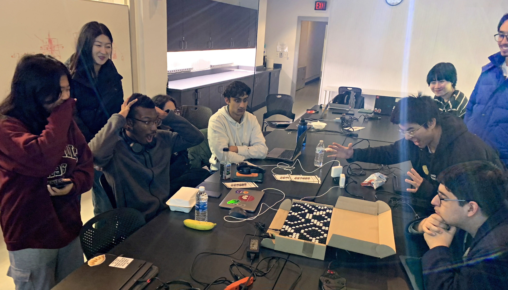
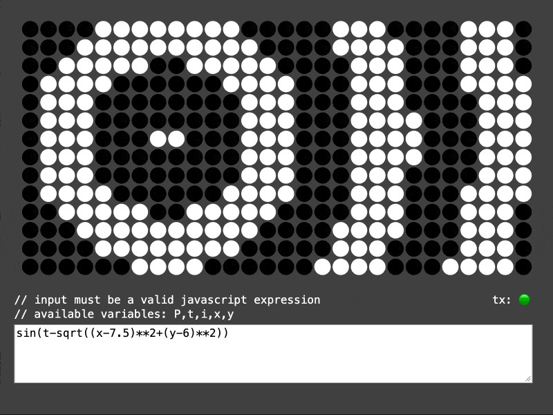

# p5-flipdots



*This project presents an API and related tooling for the realtime control of an [Alfa-Zeta XY5 flip-dot display](https://flipdots.com/en/products-services/flip-dot-boards-xy5/) with p5.js. It was developed in fall 2024 by [Yon Maor](https://www.linkedin.com/in/yonmaor/) and [Golan Levin](https://golanlevin.github.io/) with support from the [Frank-Ratchye Further Fund](https://studioforcreativeinquiry.org/frff-grants-microgrants) and the [Frank-Ratchye STUDIO for Creative Inquiry](https://studioforcreativeinquiry.org/) at Carnegie Mellon University. The current version of the project is compatible with p5.js 2.3.4 and requires either Python 3.9+ or Node.js 20+ to run the local gateway server.*


---

## Overview



[Flip-dot (or flip-disc) displays](https://en.wikipedia.org/wiki/Flip-disc_display) are widely used in transportation signage. Because of their extremely constrained colors and low resolution, they are an interesting platform for introducing foundational concepts in data-parallel computing, i.e. shader programming. This project allows you to control an electromechanical flip-dot display with the [p5.js](https://p5js.org/) framework for creative coding in JavaScript. This work was created to support an exercise in Golan Levin's [*Creative Coding*](https://github.com/golanlevin/60-212/blob/main/README.md) course (60-212) at CMU. 

We are using the following equipment: 

* [Alfa-Zeta XY5 Flipdot display, 28x14 pixels, 13.5mm dots](https://flipdots.com/en/products-services/flip-dot-boards-xy5/) (about $500)
* [USB-C to RS485/RS422 Serial Port Converter](https://www.amazon.com/OIKWAN-Converter-Adapter-Supports-Windows/dp/B0CS35249T/) ($22)
* [24V DC power supply](https://www.amazon.com/Auplf-Supply-Adapter-100-240V-Cameras/dp/B088897J2D/) ($17)

This repository includes the following: 

* Example apps in p5.js:
  * **[`ptixy`](ptixy/)**: A code-golfing sketchpad inspired by Martin Kleppe's [*tixy.land*](https://tixy.land/), intended for local use. 
  * **[`ptixy_online`](ptixy_online/)**: A version of ptixy modified for online hosting; a copy can be found [at editor.p5js.org](https://editor.p5js.org/golan/sketches/lq1DzZVjD).
  * **[`ptixy_player`](ptixy_player/)**: A runner for displaying ptixy formulae, intended for gallery display.
  * **[`ptixy_player_online`](ptixy_player_online/)**: The same runner, modified for online hosting; a copy is [at editor.p5js.org](https://editor.p5js.org/golan/sketches/8fVFZJzjP).
  * **[`canvas`](canvas/)**: An app which renders a low-resolution version of the p5.js canvas on the flipdot display.
* Gateway servers in NodeJS and Python, which serve as a bridge from p5.js to the flipdot device. Generally you would select one or the other:
  * **[`libs/javascript/`](libs/javascript/)**
  * **[`libs/python/`](libs/python/)**
* Hardware information: 
  * **[`case`](case/)**: DXF and other CAD files for creating an acrylic lasercut box for the Alfa-Zeta XY5 display. This is helpful, as the display tiles do not otherwise sit flat on a table.


---

## Setup Quickstart Instructions

### 0. TD,LR:

There are two different bridge servers to choose from: NodeJS **or** Python. To install the NodeJS version:

```
$ git clone https://github.com/golanlevin/p5-flipdots.git
$ cd p5-flipdots
$ npm install
$ npm list
$ node flipdot_server.js --configure
$ node flipdot_server.js
$ open http://localhost:8081/
```

For the alternative Python-based server, use the Python setup instructions below.


### 1. Getting Started 

Configure your serial interface before running anything! [`flipdot_config.json`](flipdot_config.json) is intentionally included in Git, but it contains the name of Golan's particular USB adapter. *Revise or delete this file for your own machine!* If you don't know the name of your USB interface,  delete the `flipdot_config.json` file (don't worry, it will get recreated).

Choose whether you want to run either the JavaScript server **or** the Python server. Each provides the sketch web server, serial bridge, and automatic recovery using only its own runtime. Both use the same browser sketches and serial protocol. Run only one of these servers at a time.

Start by firing up your Terminal, `cd` somewhere comfortable, and clone this repository:

```
$ git clone https://github.com/golanlevin/p5-flipdots.git
$ cd p5-flipdots
```

At this point, you should choose whether you wish to run the Node.js server (see step 2A) **or** the Python server (jump to step 2B). 

### 2A. How to run the Node.js (JavaScript) server

Ensure you have [npm installed](https://docs.npmjs.com/downloading-and-installing-node-js-and-npm). You will need **Node.js 20 or newer**. (Python is not required.) This project has been tested with Node.js 24. Run:

```
$ npm install
```

Ensure this worked by running:

```
$ npm list
```

You should see something like this:

```
p5-flipdots@1.0.0 /path/to/p5-flipdots
├── body-parser@1.20.3
├── concurrently@9.0.1
├── cors@2.8.5
├── express@4.21.1
└── serialport@13.0.0
```

On a new machine, choose the serial adapter once, then launch the program:

```
$ node flipdot_server.js --configure
$ node flipdot_server.js
``` 

You can add the optional `-v` flag to run the server in *verbose* mode, if you wish:

```
node flipdot_server.js -v
```

### (Or) 2B. How to run the Python server

Use Python 3.9 or newer. (Node.js and npm are not required.) From the repository directory, create a virtual environment and install pySerial:

```sh
python3 -m venv .venv
source .venv/bin/activate
python -m pip install -r libs/python/requirements.txt
python flipdot_server.py --configure
python flipdot_server.py
```

On Windows, activate with `.venv\Scripts\activate` instead of `source .venv/bin/activate`; the chooser lists COM ports. Both launchers accept `-v` for verbose output. After the first setup, activate the environment and run `python flipdot_server.py` to launch again.

### 3. Run a p5.js app (using either server)

Once one of the servers is running, navigate to [`http://localhost:8081/`](http://localhost:8081/) in your favorite web browser. This should launch the [`ptixy`](ptixy/) p5.js app, described below.  

---

## p5 Example Apps

This repo provides three browser-based p5.js apps, each of which transmits commands to the flipdot display through the NodeJS or Python gateway server. (Be sure to keep only one transmitting app open at a time.)

* **[`ptixy`](ptixy/)**: A code-golfing sketchpad inspired by Martin Kleppe's [*tixy.land*](https://tixy.land/), intended for local use. A version of this modified for online hosting can be found in [`ptixy_online`](ptixy_online/); this is also hosted [at editor.p5js.org](https://editor.p5js.org/golan/sketches/lq1DzZVjD).
* **[`ptixy_player`](ptixy_player/)**: A runner for displaying ptixy formulae, intended for gallery display. A version of this modified for online hosting can be found in [`ptixy_player_online`](ptixy_player_online/); this is also hosted [at editor.p5js.org](https://editor.p5js.org/golan/sketches/8fVFZJzjP).
* **[`canvas`](canvas/)**: An app which renders a low-resolution version of the p5.js canvas on the flipdot display.



**ptixy** is a p5.js adaptation of Martin Kleppe's [code-golfing](https://en.wikipedia.org/wiki/Code_golf) platform [*tixy.land*](https://tixy.land/), described by its creator as "[the most minimalist creative coding environment](https://x.com/aemkei/status/1323399877611708416)". As with tixy.land, we present a demonstration app in which a user's single-line JavaScript expression is used to govern the color of each pixel in the flipdot display. In addition to considering each pixel's `x`, `y`, `i` (index), and the current time `t`, our app, *ptixy*, also adds a buffer `P[]`, an array containing the previous frame's pixel states. To use *ptixy*, launch the server and navigate to `http://localhost:8081/ptixy`. Here are a few formulas you can try out:

* `sin(t / 2 + y + sin(x / 2)) > cos(t / 10)`
* `random(0,1) < (0.5 + 0.5*sin(t/30.0))`
* `sin(3*tan((t/23) * (x*cos(t/100) - y*sin(t/100)) / (10+5*sin(t/50))) / t)`
* `sin((x+y)/(cos(t/100.0)))`
* `(((x+t)^y)%9)&8`
* `t & 2**i // Binary counting (Every Icon)`

Here's Conway's Life, devised by Vera Yu:

```
((round(random()) == 1) && t%150== 0) ||
(P[i+1] + P[i-1] + P[i-28] + P[i+28] +
 P[i-28+1] + P[i+28-1] + P[i-28-1] + P[i+28+1]) == 3 ? 1 :
(P[i+1] + P[i-1] + P[i-28] + P[i+28] +
P[i-28+1] + P[i+28-1] + P[i-28-1] + P[i+28+1]) == 2 ? P[i] : 0
```


**ptixy_player** plays a looping presentation of formulas. Open [`http://localhost:8081/ptixy_player/`](http://localhost:8081/ptixy_player/) using either server. Each formula currently runs for 30 seconds; edit `makePrograms()` in `ptixy_player/sketch.js` to change the playlist, or `nSecondsToRunProgram` to change the duration (`60` for one minute). The supplied 13 formulas are preserved. Left/right arrow keys select the previous/next program, and digits 0–9 select the corresponding program number. Manual selection restarts the timer, frame count, and previous-frame memory. The current formula is shown in a read-only text area. A YouTube video showing the *ptixy_player* can be seen [here](https://www.youtube.com/watch?v=FBX2Ip7U4vs).

**Hosted versions:** `ptixy_online/` contains the working editor exported from [the p5.js Web Editor](https://editor.p5js.org/golan/sketches/lq1DzZVjD). [`ptixy_player_online/`](ptixy_player_online/readme.md) provides the corresponding player, with the same 13 formulas and current 15-second duration as the local player. Each folder includes its own `sketch.js`, `flipdot.js`, `index.html`, and `style.css`, so it can be copied into a Web Editor sketch without repository-relative libraries. Both use p5.js 2.3.4 and a Connect button for the local bridge. Start either server on the browser's computer, then click Connect and allow local access if prompted. If the API port differs from 3000, change `FLIPDOT_SERVER_URL` in that hosted sketch's `flipdot.js`. The server enforces its JSON settings; these hosted versions do not load that file themselves. Use a development server to preview these folders locally.

**canvas** leverages p5 to allow you to cast any existing p5 sketch onto the display. To use it, navigate to `./canvas/sketch.js` and write your p5 sketch in there, ensuring that `canvas2display()` is called at the end of the `draw()` function (or wherever you would like to cast the canvas to the display). To use it, launch the server and navigate to `http://localhost:8081/canvas`


---

## Related Flipdot Projects

The following projects present alternative approaches to supporting creative coding with the Alfa-Zeta XY5 flipdot display and similar devices.

* [https://github.com/owenmcateer/FlipDots](https://github.com/owenmcateer/FlipDots): Processing controller for the same display, by @owenmcateer
* [https://github.com/owenmcateer/FlipDots/tree/master/CastCanvas](https://github.com/owenmcateer/FlipDots/tree/master/CastCanvas): Accepts an image buffer over WebSockets, converts it to FlipDot data, and pushes it out over USB.
* [https://github.com/dcreemer/flipdot/blob/master/docs/XY5_arduino.txt](https://github.com/dcreemer/flipdot/blob/master/docs/XY5_arduino.txt): Arduino controller example
* [https://github.com/andydbc/Dot/](https://github.com/andydbc/Dot): C++ controller for the same display, by @andydbc
* [https://github.com/dcreemer/flipdot](https://github.com/dcreemer/flipdot): Python controller, by @dcreemer

---

<!-- 
https://editor.p5js.org/golan/sketches/lq1DzZVjD 
https://editor.p5js.org/golan/sketches/8fVFZJzjP
-->
