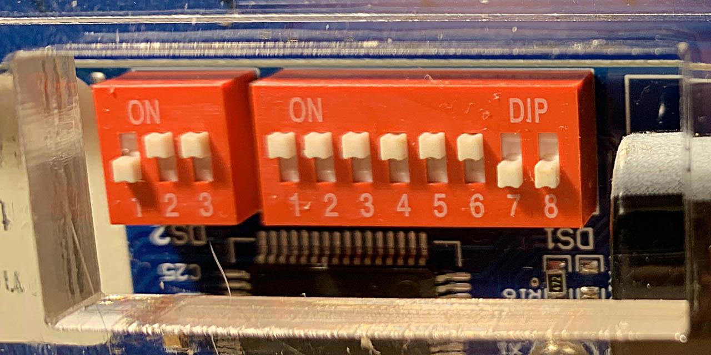

# Additional Technical Information


---

## JavaScript dependency troubleshooting

If the Node.js server reports a missing dependency, run `npm install` from the repository’s root directory. If installation problems persist, run `npm ci` to reinstall dependencies from the supplied lockfile.

---

## Hardware Setup

The 28×14 display contains two 28×7 panels, each with its own controller. Configure both controllers before starting either server.


---

## Communication speed: 57,600 baud



Both server implementations use a fixed **57,600 baud (57.6 kbit/s)**, the fastest setting documented for these XY5 controllers. Set the matching hardware DIP switches by hand.

1. Turn off the display's 24V power.
2. On **each controller**, locate the **three-switch baud-rate DIP bank**, separate from the panel-address bank.
3. Set the switches as follows:

   | Switch number | Position |
   | --- | --- |
   | 1 | **OFF** |
   | 2 | **ON** |
   | 3 | **ON** |

4. Use the printed switch numbers and the bank's **ON** marking; do not rely on which way the board is facing.
5. Restore power, then start your chosen server.

The computer and both controllers must use the same speed. Selecting a serial interface with `--configure` does not change the hardware DIP switches. These settings are documented in [Owen McAteer's XY5 setup guide](https://github.com/owenmcateer/FlipDots#2-dip-switches) and corroborated by the [AlfaZeta-supplied Arduino example preserved by dcreemer](https://github.com/dcreemer/flipdot/blob/master/docs/XY5_arduino.txt). Check the controller's own documentation if its switch layout differs.


---

## Panel addresses

The software uses fixed addresses defined by `PANEL_ADDRS` in `libs/javascript/flipdot.js`: `0x00` for panel 0 (lower half) and `0x3F` for panel 1 (upper half). With display power off, set each controller's **eight-switch address bank** to match:

| Panel | Address | 1 | 2 | 3 | 4 | 5 | 6 | 7 | 8 |
| --- | --- | --- | --- | --- | --- | --- | --- | --- | --- |
| Lower (panel 0) | `0x00` | OFF | OFF | OFF | OFF | OFF | OFF | OFF | OFF |
| Upper (panel 1) | `0x3F` | ON | ON | ON | ON | ON | ON | OFF | OFF |

On the documented eight-switch address bank, **only switches 1–6 select the address**: all six OFF gives `0x00`; all six ON gives `0x3F`. Keep switches 7 and 8 OFF for the standard magnetising time and normal operation. Do not turn all eight switches ON to select `0x3F`: the last two control magnetising time and test mode, not the address. See the [address-switch documentation](https://github.com/owenmcateer/FlipDots#address-8-pin-dip).


---

## Selecting the serial interface

Both implementations support the same options:

| Option | Behavior |
| --- | --- |
| `--list-ports` | List device paths, descriptions, and available USB identifiers, then exit. It does not open ports or send test commands. |
| `--port PATH` | Use this device path or COM port for this run. |
| `--configure` | Show an interactive numbered chooser, save its selection to `flipdot_config.json`, then exit. |
| No selection option | Use `FLIPDOT_SERIAL_PATH` if set, otherwise load `flipdot_config.json`. |
| `--help` | Show available options. |

For example:

```sh
node flipdot_server.js --list-ports
node flipdot_server.js --port /dev/tty.usbserial-YOUR_DEVICE
node flipdot_server.js --configure

# Or, with the Python environment activated:
python flipdot_server.py --list-ports
python flipdot_server.py --port COM3
python flipdot_server.py --configure
```

Selection precedence is **`--port` → `FLIPDOT_SERIAL_PATH` → `flipdot_config.json`**. Command-line and environment overrides do not change the saved file. They select the exact device path for that run. The p5 sketches work with either backend without changes.

The JSON file lives next to the launchers and is deliberately **not gitignored**. The supplied file selects the author's `/dev/tty.usbserial-A9E7G8FR` interface. New users should **revise or delete it**, or run `--configure` to update its serial selection. The chooser preserves other settings. Saving a selection changes this tracked project file. A minimal configuration is:

```json
{
  "serialPort": "/dev/tty.usbserial-YOUR_DEVICE"
}
```

The chooser also records `serialNumber`, `vendorId`, and `productId` when available. A saved USB serial number lets the worker recognize the selected adapter after its device path changes; USB vendor/product identifiers are checked when the platform supplies them. The two implementations recognize equivalent macOS `tty.*` and `cu.*` paths for that saved identity. If the adapter is absent, recovery waits for it. If its identity is ambiguous, it refuses to guess; use `--configure` to select an interface again. A configuration without a USB serial number reconnects using its exact saved path.

Both versions of `--configure` preserve existing installation settings and explicitly write defaults for any missing `webPort`, `httpPort`, and `transmitEnabled` fields. Older identity-only configurations remain valid and use those same defaults when read. Environment overrides apply only to the current run and are not written by the chooser.


---

## Installation settings

Both server implementations (Python and JavaScript) read the same settings file, `flipdot_config.json`. 

Every field can be omitted; defaults are defined independently in `libs/javascript/settings.js` and `libs/python/settings.py`. If the JSON file is deleted, those defaults still apply. There is no default serial adapter: with transmission enabled, choose one using `--configure`, `--port`, or `FLIPDOT_SERIAL_PATH` before starting.

The supplied configuration is:

```json
{
  "serialPort": "/dev/tty.usbserial-A9E7G8FR",
  "serialNumber": "A9E7G8FR",
  "vendorId": "0403",
  "productId": "6001",
  "webPort": 8081,
  "httpPort": 3000,
  "transmitEnabled": true
}
```

| Setting | Default and meaning |
| --- | --- |
| `webPort` | `8081`: sketch web server port. |
| `httpPort` | `3000`: serial HTTP API port. The shared browser library reads it automatically. |
| `transmitEnabled` | `true`: permit serial output. Set `false` for preview mode; neither server opens the serial adapter or writes bytes, even if a browser still requests transmission. Preview mode can run without a selected adapter. |

Restart the launcher and reload the sketch after changing settings. The server enforces `transmitEnabled` in addition to each sketch's `ENABLE_TX` flag; **both must be true** to move dots. Your existing serial path and physical addresses are unchanged by the supplied settings.

The built-in web servers expose only nonprivate settings at `/flipdot_config.json`; serial paths and USB identities stay private. A separate development server such as Live Server serves the on-disk file instead, and the browser reads it relative to the shared library. With Live Server, configure `httpPort` in JSON so both the sketch and bridge use the same port. If the file is missing, browser defaults match the server defaults; an unreadable or invalid settings response pauses transmission and retries.

Interface numbers are only used within the chooser and are never saved. The program never chooses the first port or an arbitrary FTDI adapter. If the configuration is missing and no override is supplied, startup lists the interfaces and explains how to choose one, then exits before starting either worker. Invalid configuration also stops startup with an explanation. For unattended installations, configure the adapter first; subsequent launches need no input.


---

## Automatic recovery

Run either `node flipdot_server.js` or `python flipdot_server.py`. Each launcher supervises its own serial bridge and web server; neither invokes the other runtime:

* A worker that exits is restarted after one second. Repeated failures back off to a maximum of ten seconds between attempts, so an unplugged adapter can be reconnected without restarting the launcher. After a worker runs for 30 seconds, the restart delay resets.
* The serial bridge sends a heartbeat every second. If the supervisor receives no heartbeat for five seconds, it terminates the worker, forcibly kills it after another second if necessary, and starts a replacement.
* Serial open, write, and drain operations have a two-second deadline. Errors, disconnections, and timeouts cause the worker to exit and reopen the device in a fresh process.
* Each animation frame sends both panel buffers and the update command in one request. The browser allows one request at a time, keeps only the latest pending frame, aborts stalled requests after four seconds, and retries after one second. Animation continues during an outage and transmission resumes automatically.
* The bridge writes one request at a time and permits at most 32 waiting requests. It rejects malformed commands and overflow instead of building an unlimited serial queue.

A previous version of the JavaScript launcher used `exec()`, which accumulated child output and could kill a worker when its output buffer filled. It now uses `spawn()` and continuously consumes output. The Python launcher uses Python's `multiprocessing` with a separate heartbeat pipe for each worker. Both web servers have heartbeat monitoring. Raw frame commands are no longer logged. Startup, failure, and restart messages include timestamps and worker PIDs. Ctrl+C stops both workers without restarting them. The web server reuses its configured port after a restart.

After updating these files, restart your chosen launcher once and hard-refresh the open sketch to load the new browser transport. You do not need to change your Ptixy expression or p5 sketch. Keep only one transmitting sketch open. To switch implementations, stop the current launcher with Ctrl+C before starting the other one; both use the same ports and device.

Inspect `http://localhost:3000/health` for the bridge PID, serial readiness, current write activity, queue depth, and last completed write time. An idle sketch does not trigger a restart. A typical serial timeout recovers in a few seconds; a completely blocked worker takes roughly 6–8 seconds, plus device opening and browser retry time. Repeated failures take longer because of the backoff.

To choose a different serial adapter without editing the source:

```sh
FLIPDOT_SERIAL_PATH=/dev/tty.usbserial-YOUR_DEVICE node flipdot_server.js
# Or, with the Python environment activated:
FLIPDOT_SERIAL_PATH=/dev/tty.usbserial-YOUR_DEVICE python flipdot_server.py
```

Both launchers support the same environment variables. `FLIPDOT_WEB_PORT` and `FLIPDOT_HTTP_PORT` override `webPort` and `httpPort` in JSON for that run. Sketches served by the built-in web server receive these overrides automatically. Ports must be distinct integers from 1 to 65535. Serial communication uses 57600 baud in both server implementations.

For JavaScript tests, run `npm test` with Node.js 20 or newer. For Python tests, run `python -m unittest discover -s test -p 'test_python.py' -v`. Each suite runs independently of the other runtime. The tests cover sketch hosting, crashes, lost heartbeats, serial timeouts, disconnected devices, queue limits, and recovery; JavaScript tests also check large worker output and browser retries. They use fake serial devices and temporary HTTP ports, without accessing the display.

The watchdog detects process and serial transport failures. This protocol provides no display acknowledgement, so it cannot detect a powered-off or mechanically stuck panel when the adapter still accepts bytes. It also needs the launcher to remain running; recovery after a computer reboot or termination of the launcher itself requires an OS service manager such as macOS `launchd`.


---

## Project Structure

Here is the project structure, which may be helpful if you decide to fork this repo and make something crazy.

```
p5-flipdots/
├── index.html # home page
├── canvas/ # the canvas control method (as described above)
│   ├── index.html
│   └── sketch.js
├── ptixy/ # the ptixy control method (as described above)
│   ├── index.html
│   └── sketch.js
├── ptixy_player/ # looping formula presentation
│   ├── index.html
│   └── sketch.js
├── ptixy_online/ # self-contained editor for the p5.js Web Editor
├── ptixy_player_online/ # self-contained player for the p5.js Web Editor
├── libs/
│   ├── javascript/
│   │   ├── flipdot.js # shared browser library for either backend
│   │   ├── ptixy.js # protected expression evaluation for editor and player
│   │   ├── server.js # JavaScript serial HTTP bridge
│   │   ├── web.js # JavaScript sketch web server
│   │   ├── serial_config.js # discovery and saved interface selection
│   │   ├── settings.js # installation defaults and validation
│   │   └── supervisor.js # JavaScript watchdog
│   └── python/
│       ├── requirements.txt # Python dependencies (pySerial)
│       ├── server.py # Python serial HTTP bridge
│       ├── web.py # Python sketch web server
│       ├── serial_config.py # discovery and saved interface selection
│       ├── settings.py # installation defaults and validation
│       └── supervisor.py # Python watchdog
├── flipdot_server.js # JavaScript-only launcher
├── flipdot_server.py # Python-only launcher
├── flipdot_config.json # tracked installation settings; revise or delete for your machine
└── node_modules, package.json, docs, assets, etc... # other stuff
```

